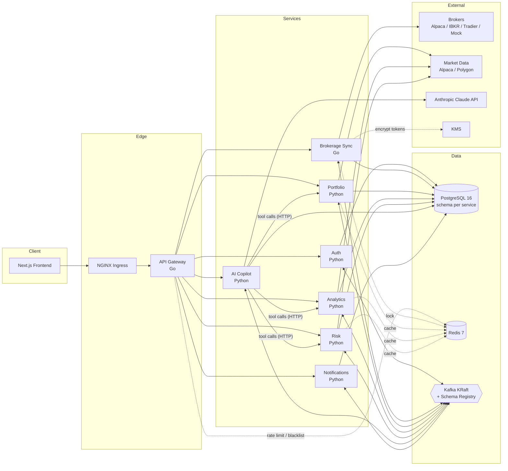
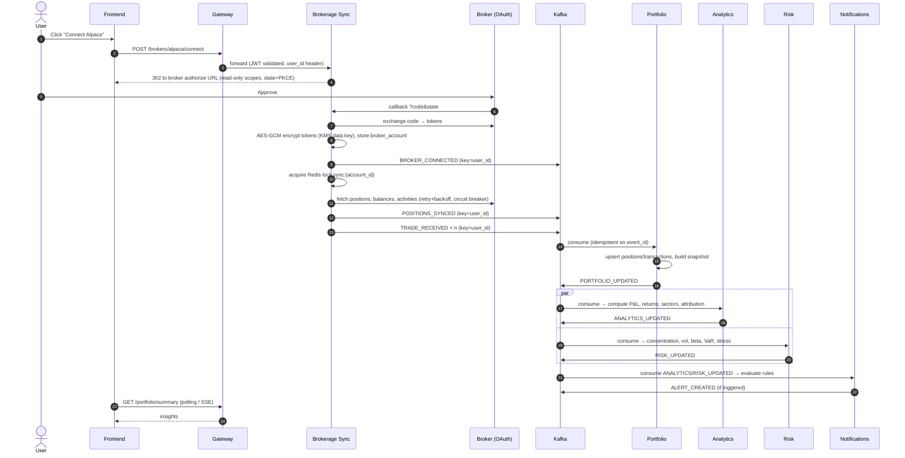
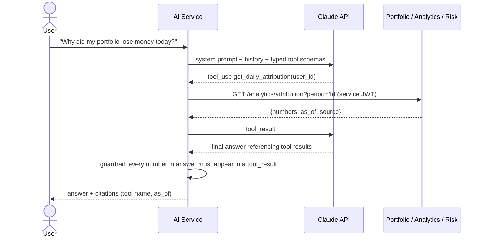

# ATLAS AI — Architecture

Status: **Phase 0 approved 2026-10-22.** Decisions recorded in `docs/decisions/`.

ATLAS AI is a read-only portfolio intelligence platform. Users connect brokerage accounts via OAuth; the system syncs holdings and transactions, computes performance and risk analytics, and exposes an AI copilot that answers questions using only numbers computed by backend services.

## 1. System diagram

## 2. Service boundaries

| Service | Lang | Owns (Postgres schema) | Does NOT own |
|---|---|---|---|
| **Gateway** | Go | nothing (stateless) | business logic; it authenticates, routes, rate-limits |
| **Auth** | Python | `auth.users`, `auth.refresh_tokens`, `audit.audit_logs` (auth events) | broker credentials |
| **Brokerage Sync** | Go | `sync.broker_accounts` (encrypted OAuth tokens), `sync.sync_runs`, `sync.raw_snapshots` | normalized holdings, analytics |
| **Portfolio** | Python | `portfolio.positions`, `portfolio.transactions`, `portfolio.balances`, `portfolio.snapshots` | returns/risk math |
| **Analytics** | Python | `analytics.daily_performance`, `analytics.attribution`, `analytics.sector_allocation` | raw positions (receives via events) |
| **Risk** | Python | `risk.risk_metrics`, `risk.stress_results` | performance attribution |
| **AI** | Python | `ai.conversations`, `ai.messages`, `ai.tool_calls` | any financial number — all numbers come from tool calls |
| **Notifications** | Python | `notifications.rules`, `notifications.alerts` | metric computation |

Rules:
- **No cross-schema reads.** Each service has its own Postgres role with grants only on its schema. Data moves via Kafka events or HTTP APIs.
- One Postgres *instance* (cluster) locally and in RDS, separate *schemas* + roles. This gives ownership isolation without operating 7 databases; splitting to separate instances later is a config change. (ADR-0003)
- Analytics and Risk keep **local read models** of positions built from `PORTFOLIO_UPDATED` events, so they never call Portfolio synchronously on the hot path.

## 3. Data flow

### 3.1 Connect broker → first insights

### 3.2 Copilot question

The number-traceability guardrail is enforced in code (extract numerics from the answer, match against tool outputs within rounding tolerance); a failing answer is regenerated once, then returned with unverifiable figures stripped.

## 4. Kafka topics

| Topic | Producer | Consumers (group) | Key |
|---|---|---|---|
| `user.created.v1` | Auth | Notifications (`notif`) | user_id |
| `broker.connected.v1` | Sync | Notifications, Portfolio | user_id |
| `positions.synced.v1` | Sync | Portfolio (`portfolio`) | user_id |
| `trade.received.v1` | Sync | Portfolio | user_id |
| `portfolio.updated.v1` | Portfolio | Analytics, Risk, AI (cache bust) | user_id |
| `analytics.updated.v1` | Analytics | Notifications, AI | user_id |
| `risk.updated.v1` | Risk | Notifications, AI | user_id |
| `alert.created.v1` | Notifications | (frontend push / email worker) | user_id |
| `ai.query.created.v1` | AI | (audit / usage metering) | user_id |

Every topic has a `<topic>.retry` and `<topic>.dlq`. Envelope: `event_id` (UUIDv7), `event_type`, `schema_version`, `occurred_at`, `user_id`, `trace_context`, `payload`. Consumers record processed `event_id`s in a per-service `processed_events` table inside the same transaction as the side effect → exactly-once *effects* on top of at-least-once delivery. Partition by `user_id` gives per-user ordering. Schemas: **JSON Schema** in `libs/events` with Schema Registry (ADR-0005: simpler codegen across Go/Python than Avro, human-readable payloads for debugging; trade-off is larger messages).

## 5. Redis usage

| Use | Key | TTL | Invalidation |
|---|---|---|---|
| Portfolio snapshot | `portfolio:snap:{user_id}` | 10 min | `portfolio.updated` |
| Analytics result | `analytics:{user_id}:{metric}:{period}` | 15 min | `analytics.updated` |
| Risk result | `risk:{user_id}:{metric}` | 15 min | `risk.updated` |
| Market price | `px:{symbol}` | 60 s market hours / 12 h closed | TTL only |
| Rate limit | `rl:{user_id\|ip}:{window}` | window | sliding window (Lua) |
| Sync lock | `lock:sync:{account_id}` | 5 min + heartbeat renewal | released on completion |
| JWT blacklist | `jwt:deny:{jti}` | token remaining lifetime | — |

## 6. Key trade-offs (honest)

1. **Microservices vs. modular monolith.** For one developer and low traffic, a modular monolith would be simpler, faster to build, and easier to test. Microservices are chosen deliberately to demonstrate distributed-systems skills; the real justification that survives scrutiny is *workload isolation*: broker sync is I/O-bound and bursty, analytics/risk are CPU-bound pandas jobs, and the copilot is latency-bound on an external LLM. Different scaling profiles → separate deployables.
2. **Go for Gateway & Sync, Python elsewhere.** Go handles thousands of concurrent broker HTTP calls with low memory; Python owns the numerical stack (pandas/NumPy). Cost: two toolchains, schemas must be language-neutral.
3. **Events for propagation, HTTP for queries.** State changes flow through Kafka (decoupled, replayable). The copilot uses synchronous HTTP tool calls because it needs a fresh answer within one request.
4. **Eventual consistency.** Analytics can lag positions by seconds. Every response carries `as_of`; the UI and copilot show it.
5. **Shared Postgres cluster, separate schemas.** Ownership enforced by roles, not by physical isolation — a pragmatic middle ground.
6. **Read-only brokers.** No trade execution means no order-management complexity and a much smaller security blast radius; OAuth scopes are validated on callback and connections with write scopes are rejected.
7. **Kafka over simpler queues (SQS/Redis Streams).** Chosen for replay, consumer groups, per-key ordering and fan-out to many consumers. Operationally heavier; MSK offsets that in prod.

## 7. Security

- Passwords: argon2id. Access JWT 15 min (RS256, gateway verifies with public key), refresh token 30 days rotated, stored hashed.
- Broker tokens: envelope encryption — per-record data key via KMS (local static key in dev), AES-256-GCM, account_id as AAD.
- Service-to-service: internal JWT minted by gateway carrying `user_id`; services never trust a client-supplied user id.
- Audit log of logins, broker connects/disconnects, copilot queries.

## 8. Observability

Every service: `/health` (liveness), `/ready` (DB/Redis/Kafka reachable), `/metrics` (Prometheus). OpenTelemetry traces propagated over HTTP (`traceparent`) and Kafka headers, exported to Jaeger. JSON logs with `trace_id`, `user_id`, `service`.

## 9. Planned ADRs (docs/decisions/)

0001 Microservices with honest monolith comparison · 0002 Go for gateway and sync · 0003 Schema-per-service on shared Postgres · 0004 Kafka as event backbone · 0005 JSON Schema over Avro · 0006 Idempotent consumers via processed_events · 0007 Copilot tool-calling with number verification · 0008 Envelope encryption for broker tokens · 0009 Mock broker as first-class adapter.

## 10. Resolved decisions (approved 2026-10-22)

1. Events: **JSON Schema** + Schema Registry (ADR-0005).
2. Postgres: **shared cluster, schema-per-service**, one role per service (ADR-0003).
3. Tooling: **uv** for Python, **chi** for Go HTTP, **franz-go** for Kafka (ADR-0010).
4. Market data: **Alpaca market data** behind a `MarketDataProvider` adapter; Polygon pluggable later (ADR-0011).
